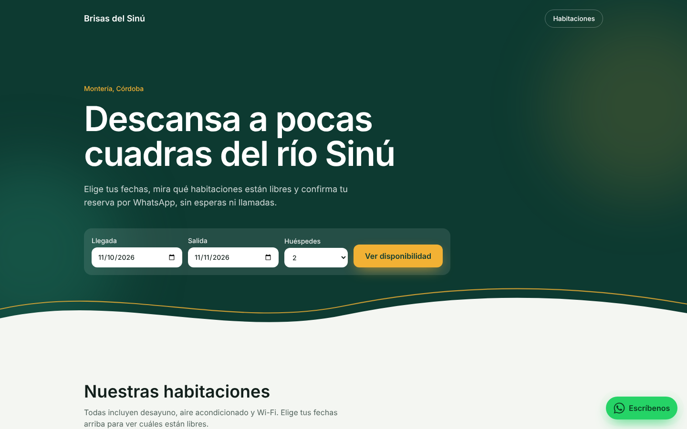
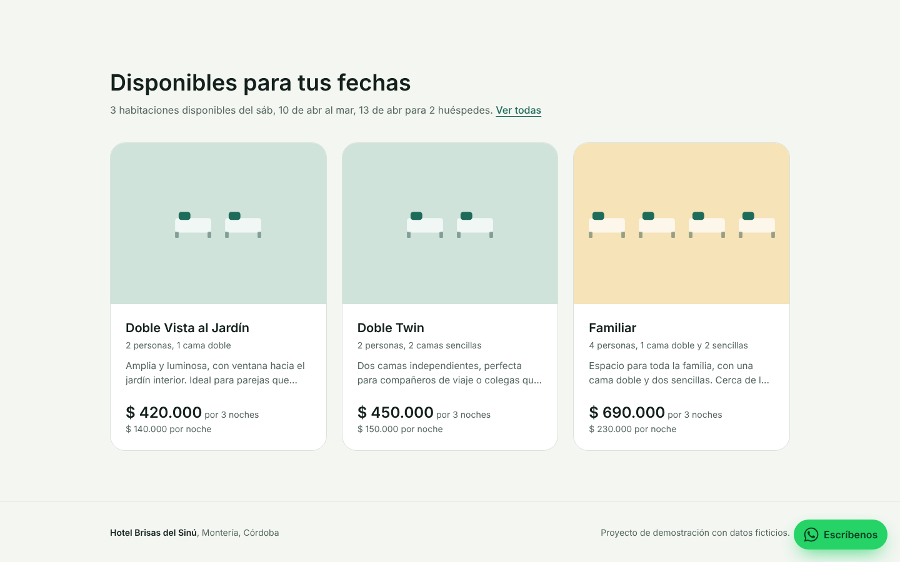
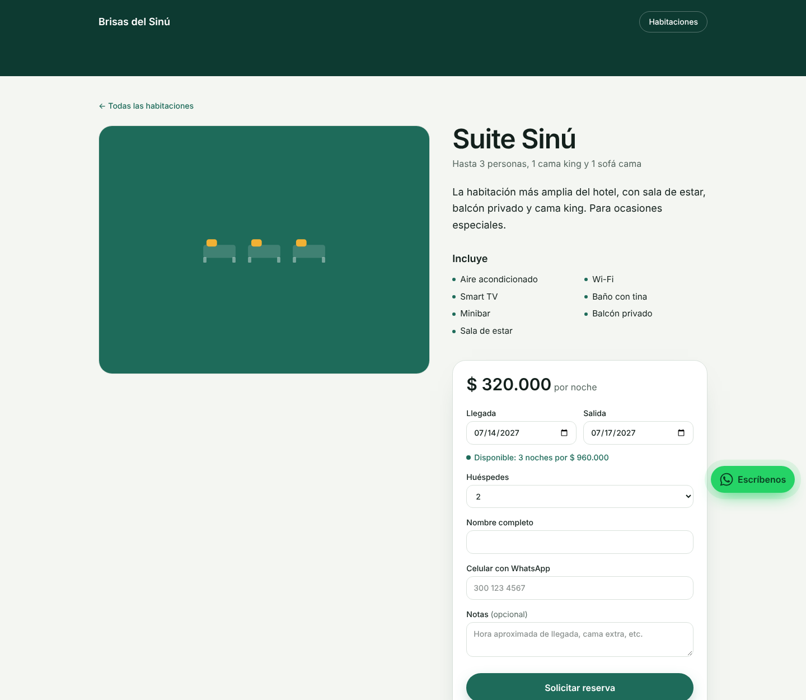
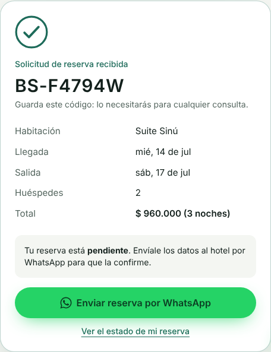
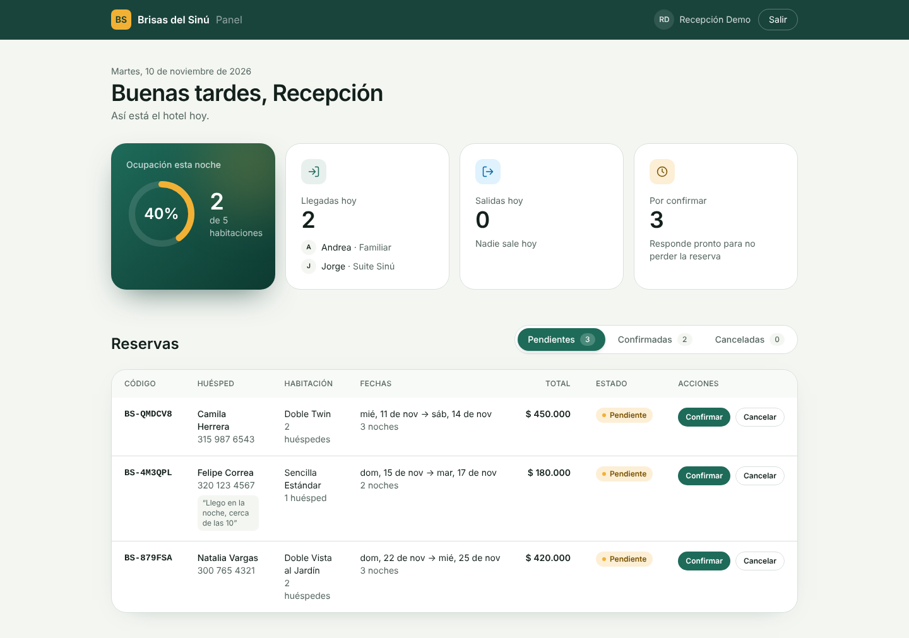

# Hotel Brisas del Sinú · Sistema de reservas

Sistema de reservas para un hotel pequeño que hoy gestiona todo por WhatsApp. El huésped consulta disponibilidad real y solicita su reserva en línea; el hotel la confirma desde un panel y responde por WhatsApp con un clic. **Sin reservas dobles, sin mensajes perdidos y sin cambiar la forma en que el hotel ya trabaja.**

**[Ver la aplicación en vivo](https://URL-DE-VERCEL)** · Panel: `/ingresar` → botón **Entrar como demostración**



## El problema

Muchos hoteles pequeños en Colombia reciben las reservas por WhatsApp y las anotan en un cuaderno o en Excel. Eso genera reservas dobles cuando dos personas piden la misma habitación, mensajes que se pierden entre conversaciones y horas de ida y vuelta para confirmar fechas y precios.

## La solución

- **Disponibilidad real:** el huésped elige fechas y solo ve las habitaciones libres, con el total de su estadía.
- **Cero reservas dobles, garantizado por la base de datos**, incluso si dos personas reservan al mismo tiempo.
- **WhatsApp como canal, pero ordenado:** al reservar, el huésped envía al hotel un mensaje con todos los datos ya escritos; desde el panel, el hotel confirma o cancela y le responde con un clic.
- **Panel del hotel:** ocupación de la noche, llegadas y salidas del día, y reservas por confirmar.

| Disponibilidad por fechas | Detalle y reserva |
| --- | --- |
|  |  |

| Confirmación | Panel del hotel |
| --- | --- |
|  |  |

## Tecnologías

| Capa | Tecnología |
| --- | --- |
| Framework | Next.js 15 (App Router, componentes de servidor, middleware) |
| Lenguaje | TypeScript en modo estricto |
| Base de datos | MongoDB Atlas con Mongoose |
| Validación | Zod, con las mismas reglas en la API y en los formularios |
| Autenticación | JWT (jose) en cookie `HttpOnly`, contraseñas con bcrypt |
| Estilos | Tailwind CSS 4, animaciones CSS propias |
| Despliegue | Vercel |

## Decisiones técnicas destacadas

**Reservas dobles imposibles, incluso con peticiones simultáneas.** Cada noche reservada se guarda como un documento en la colección `ocupaciones`, que tiene un índice único sobre `(habitación, fecha)`. Si dos personas reservan la misma noche al mismo tiempo, MongoDB acepta la primera y rechaza la segunda; si una reserva falla a mitad del proceso, se deshace todo lo que alcanzó a guardar. Probado con 10 reservas simultáneas de la misma habitación y fechas: 1 aceptada, 9 rechazadas, sin datos huérfanos.

**Fechas como días del calendario.** Las fechas se guardan como texto `AAAA-MM-DD` y "hoy" se calcula en la zona horaria de Colombia. Una reserva es para un día, no para un instante: así se evita el error clásico en que una reserva del 15 aparece el 14 por la diferencia con UTC.

**El servidor calcula el precio.** El navegador solo muestra un estimado; el total real sale del precio guardado en la base de datos. La reserva conserva una copia del precio ofrecido, por si el hotel cambia sus tarifas después.

**Cambios de estado atómicos.** Una reserva pendiente puede confirmarse o cancelarse; una confirmada solo cancelarse; una cancelada no se reactiva, porque sus noches ya se liberaron. La actualización solo ocurre si la reserva sigue en el estado esperado, en una sola operación: si dos recepcionistas actúan a la vez, solo una acción gana.

**Seguridad del panel en dos capas.** El middleware bloquea el panel y su API antes de llegar a la página, y cada página y ruta vuelve a verificar la sesión. La cookie es `HttpOnly` y `SameSite=Lax`; el inicio de sesión responde igual (y tarda lo mismo) con un correo inexistente que con una contraseña incorrecta, y valida el destino para evitar redirecciones a sitios externos.

**WhatsApp con enlaces `wa.me`.** Son gratuitos, funcionan de inmediato y respetan cómo ya trabaja el hotel. La API oficial de WhatsApp Business requiere verificación de Meta y cobra por conversación; el diseño permite migrar a ella cuando el volumen lo justifique.

## API

| Método | Ruta | Descripción |
| --- | --- | --- |
| GET | `/api/habitaciones` | Habitaciones activas |
| GET | `/api/habitaciones/:slug` | Detalle de una habitación |
| GET | `/api/disponibilidad?llegada=&salida=&huespedes=` | Habitaciones libres para un rango, con el total |
| POST | `/api/reservas` | Crea una reserva pendiente. `409` si la habitación ya no está disponible |
| POST | `/api/auth/ingresar` · `/api/auth/salir` | Inicio y cierre de sesión |
| GET | `/api/panel/reservas?estado=` | Reservas del panel (requiere sesión) |
| PATCH | `/api/panel/reservas/:id` | Confirma o cancela una reserva (requiere sesión) |

## Estructura

```
src/
├── app/
│   ├── page.tsx                 # Inicio con buscador de disponibilidad
│   ├── habitaciones/[slug]/     # Detalle y formulario de reserva
│   ├── reservas/[codigo]/       # Estado público de una reserva
│   ├── ingresar/                # Inicio de sesión del panel
│   ├── panel/                   # Panel del hotel (protegido)
│   └── api/                     # API REST
├── components/                  # Interfaz del sitio y del panel
├── lib/                         # Lógica: reservas, fechas, validación, sesiones, WhatsApp
├── models/                      # Habitacion, Reserva, Ocupacion, Usuario
└── middleware.ts                # Protección del panel
scripts/
├── seed.ts                      # Carga las habitaciones de ejemplo
└── crear-admin.ts               # Crea un usuario del panel
```

## Ejecutarlo en local

Requisitos: Node.js 20 o superior y una base de datos en [MongoDB Atlas](https://www.mongodb.com/atlas) (el plan gratuito es suficiente).

```bash
git clone https://github.com/DanielDiaz2805/hotel-reservas.git
cd hotel-reservas
npm install
cp .env.example .env.local      # y completa los valores
npm run seed                    # carga las habitaciones
npm run crear-admin -- correo@ejemplo.com "Tu Nombre" "TuContraseña"
npm run dev
```

Abre http://localhost:3000. El panel está en http://localhost:3000/ingresar.

### Variables de entorno

| Variable | Descripción |
| --- | --- |
| `MONGODB_URI` | Cadena de conexión de MongoDB Atlas, con la base de datos `hotel` |
| `JWT_SECRET` | Clave para firmar las sesiones, mínimo 32 caracteres |
| `WHATSAPP_HOTEL` | Celular del hotel, 10 dígitos |
| `DEMO_EMAIL`, `DEMO_PASSWORD` | Opcionales: activan el botón "Entrar como demostración" |

## Próximos pasos

- Pagos de anticipo en línea (Wompi o Mercado Pago).
- Migración a la API de WhatsApp Business para enviar confirmaciones automáticas.
- Gestión de habitaciones, fotos y temporadas de precios desde el panel.
- Pruebas automatizadas de la lógica de disponibilidad y límite de intentos en el inicio de sesión.

## Autor

**Daniel Diaz Montiel**, Ingeniero de Sistemas y desarrollador full stack.
[Portafolio](https://danieldiaz2805.github.io) · [LinkedIn](https://www.linkedin.com/in/daniel-diaz-225855294) · [GitHub](https://github.com/DanielDiaz2805)

*El hotel y todos sus datos son ficticios.*
